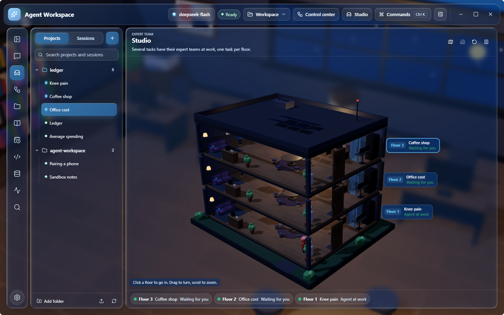
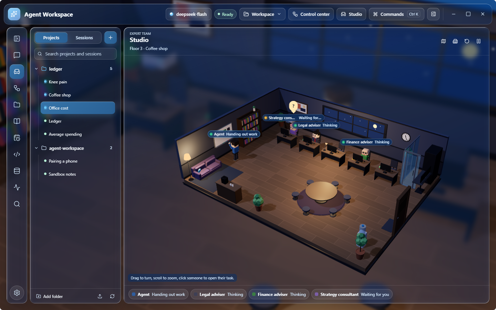
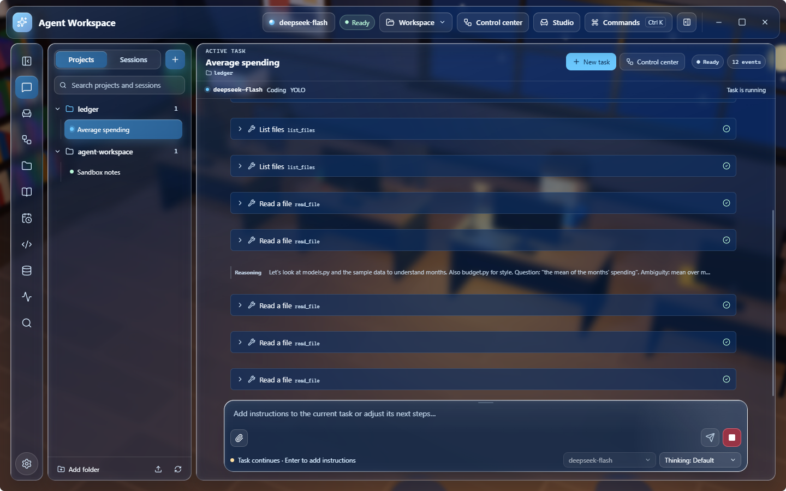
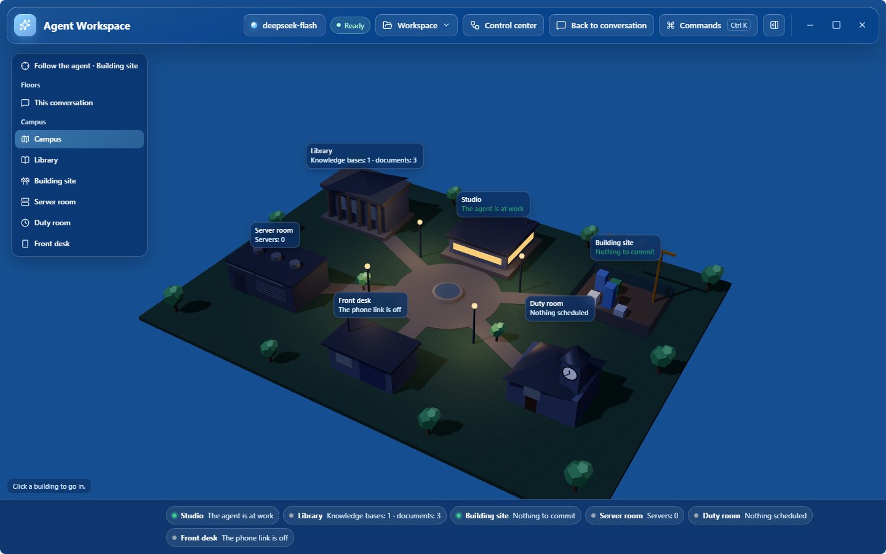
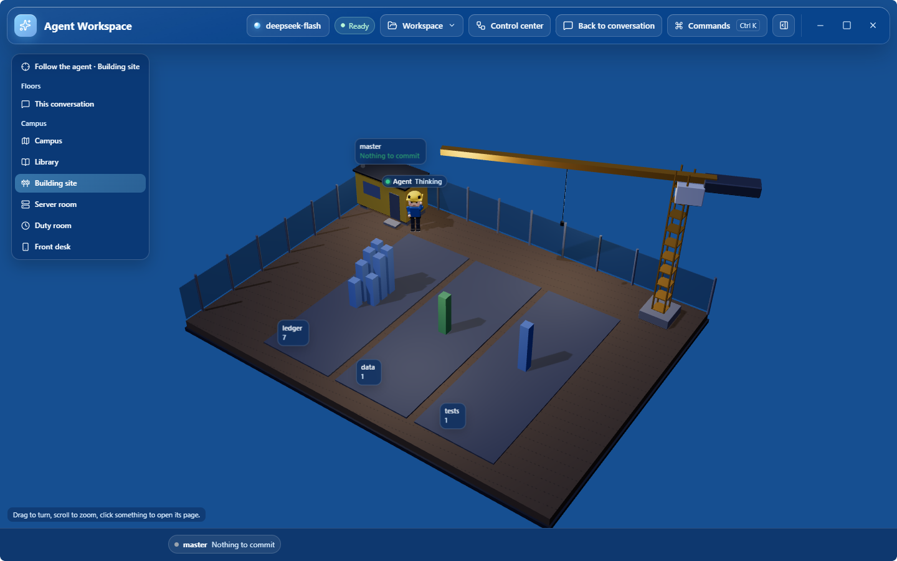
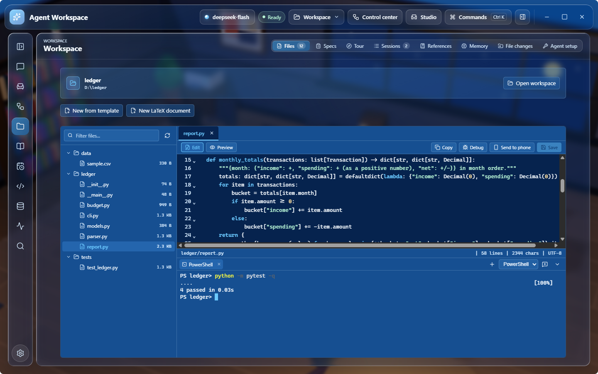

[English](README.md) | [简体中文](README.zh-CN.md)

# Agent Workspace for Windows

A desktop AI agent for Windows. Open a folder, describe the task, and the agent plans and carries
it out with real tools — files, Git, a staged sandbox for commands, a terminal, the web, documents
and your own knowledge base — asking before anything that changes your files or reaches the
network. It works with the cloud model you choose or a model served on your own computer, and
keeps every conversation, change and approval on this machine. A request can also go to a team of
specialists that the agent leads. Behind the conversation is a 3D studio where the agent, its
sub-agents and the teams can be seen at work.

The Android app ([agent-workspace-android](https://github.com/WhitePepperLambSoup/agent-workspace-android))
shares the same Python core; a phone running version 2.5.0 or later can connect to this computer.

> Status: public preview (`0.2.0-alpha`). Windows 10 and 11, x64. Releases are not code-signed yet.

<p align="center">
  
</p>

## Download

Download `AgentWorkspace-Setup-<version>.exe` from the
[latest release](https://github.com/WhitePepperLambSoup/agent-workspace-desktop/releases/latest) and
compare its SHA-256 with the one in the release notes. Windows SmartScreen warns about unsigned
installers: choose "More info", then "Run anyway". Installed copies can update themselves from the
releases page (Settings → About & Updates); they check only when you ask.

## Features

### Expert team and studio

Send a request to the expert team and the agent leads it. It picks the specialists the request
needs from a library of 73 experts in 15 fields (or uses the team you set), gives each a part,
has a reviewer check the draft when the answer carries figures or a consequential decision, and
answers from the findings that hold up. The experts work at the same time, each with the tools of
its field; experts who write code run their tests in the sandbox.

The studio shows each team in a 3D office: the lead at the board handing out the parts, the
experts at their desks reading, computing or writing, and the review at the round table. When
several conversations have a team at work, each gets a floor of one building; click a floor to go
in, or a person to open their task.

<p align="center">
  
</p>

### The studio behind the conversation

Under liquid glass, the conversation's studio is the window's backdrop, blurred and dimmed so the
text stays readable. The agent works in it as the task goes: at the desk on the web, at the shelf
with the knowledge base, at the printer with a document it made, at the window while it thinks.
Sub-agents it hands work to come in by the door, work at the free desks and leave when they are
done. Studio in the title bar shows it in full, and Esc goes back. On a slow computer, Settings →
Appearance → Backdrop switches to the colour field; without GPU acceleration the window uses the
colour field by itself.

<p align="center">
  
</p>

Shown in full, the view follows the agent to where its work is: the library while it searches the
knowledge base or papers, the building site while it writes and tests code, the server room while
it runs commands on a server. The campus around the studio also has a duty room for scheduled
tasks and a front desk for the phone connection. Each place is drawn from what is on this computer
(the open folder's files and Git state, the knowledge bases, the hosts of `~/.ssh/config`), and
clicking something opens its page.

<p align="center">
  
  
</p>

### Conversations and tasks

- **Multi-step tasks**: the agent plans, calls tools and shows every step as it happens —
  streaming replies, reasoning, and each tool call's arguments, result and state.
- **Approvals**: four autonomy levels. Ask approves every action; Workspace allows reads and
  checkpointed writes inside the open folder and asks for the rest; YOLO runs sandboxed work
  without asking; Full access removes routine prompts, as an explicit choice.
- **Talk to a running task**: messages typed while a task runs join it at the next step; others
  wait in a queue that survives restarts.
- **Several conversations at once**: a conversation keeps running in the background while you
  work in another.
- **Fork and compare**: rewrite a message in a new conversation, branch from a reply, or ask the
  same question of another model and compare both answers with their time and tokens.
- **Spending limits**: a per-task limit on cost (at list prices) and tokens; before you send, the
  composer estimates what a task like your recent ones costs. A task that reaches the limit, or
  fails at the provider, stops with the reason in the conversation.
- **Agent runs**: long work split into a plan with sub-agents, each with its own progress,
  approvals and results.
- **What changed**: each answer ends with the files its task created, edited, moved or deleted.
  Open one in the app, see what changed in an edited text file, or undo the agent's changes one
  file at a time or all together. Files that commands changed are listed apart.

<p align="center">
  
</p>

### Workspace and coding

- Read, search, write and patch files; every write keeps a checkpoint so an interrupted change
  rolls back. Moves and deletes check the content they expect.
- **Staged sandbox**: commands run in a private copy of the folder and come back as a changeset
  you review and apply one change at a time.
- Git status, diff, blame, log and staged-only commits; background jobs with logs; a code map.
- **Editor**: syntax colouring, the language server's errors, hover and go to definition.
  Ctrl+K rewrites the selection from an instruction and shows the change before it is kept;
  inline completion (DeepSeek) can be turned on.
- **Language servers**: Pyright and the TypeScript server are installed on first use;
  rust-analyzer, gopls and clangd are used when the computer has them. The agent finds
  definitions, references and symbols through them and sees a file's errors after each edit.
- **Project checks**: tests, type check and lint, detected or set in `.agent/project.json` and
  accepted once per folder, run after a task that changed files; a failure can go back to the
  agent. Project rules can format files after a write, protect paths, and refuse a commit whose
  staged changes look like they contain a secret.
- **Terminal**: PowerShell, cmd, Git Bash, each WSL distribution and the SSH hosts in
  `~/.ssh/config`, in a panel under the workspace (Ctrl+\`); the agent can read what is on
  screen and run commands in WSL.
- **Debugger**: breakpoints in the editor, the call stack and variables for Python (debugpy,
  installed on first use). The agent can stop at a line and read the variables.
- **Page check**: the agent opens a page in a hidden browser, clicks through steps, and gets
  the console errors, failed requests and a screenshot.
- **Reviewing changes**: undo or comment on each hunk, a review by the model as comments on
  the lines, and a comment handed to the agent as a task.
- **Git**: branches, commit messages written from the diff, conflicts, pull request checks
  with their failed logs (GitHub CLI) and issues as tasks.
- **Specs**: requirements, design and task list, each approved in turn before the agent builds.
- **Repository tour**: a map of the modules and their imports, and an overview of the
  architecture written from the code.
- **Expert team on code**: experts who write code get the same tools and run their tests in the
  sandbox; the lead gives them parts that can be tested on their own.
- Workspace setup the agent follows: `AGENTS.md`, skills in `.agent/skills`, MCP servers in
  `.agent/mcp.toml` and custom tools in `.agent/tools` — each approved before it first runs.
- A managed browser for pages that need scripts, with screenshots in the conversation.
- **Preview in the app**: web pages from answers, and pages, PDFs and pictures in the folder, open
  in a preview inside the window; other text files open in a reader, Word, Excel and PowerPoint
  files in their own preview.

<p align="center">
  
</p>

### Knowledge base

Add manuals, contracts, notes and e-books (PDF, Word, Excel, EPUB, web pages, Markdown and text)
on the Knowledge base page or by asking. Their text is split into passages and indexed on this
computer; conversations in every workspace can search them, and answers cite the document and
page. Scanned PDFs are read with the text recognition built into Windows. Documents can be sorted
into knowledge bases ("Work", "Study"); each conversation uses the ones you choose in the context
panel. Search is by key words with built-in and your own synonyms, so it costs nothing and works
offline.

<p align="center">
  
  
</p>

### Skills

Instructions for everyday jobs that conversations in every folder can use: reading contracts and
long documents, analysing tables, keeping accounts, meeting minutes, polishing and translating,
résumés, work reports, study cards, trip plans, meal plans, splitting bills and spotting scams.
They are adapted from the Android app's official skills, without the ones that operate a phone.
A conversation lists only their names and uses, and the agent reads one in full when a request
needs it. Turn them on or off in Settings → Skills, or add your own by copying a folder with a
`SKILL.md` file (the format of the Android app and other agents) into the skills folder.

### Research and memory

- Research mode keeps the pages the agent read as sources and checks that every citation quotes
  them exactly.
- Long-term memory per workspace, searched only when the agent asks for it; you can review, edit
  and delete it.

### Science and papers

- **Literature**: the agent searches OpenAlex, arXiv, PubMed, Crossref and Semantic Scholar, keeps
  a reference library per folder (imports from Zotero, BibTeX, RIS, EndNote and NoteExpress),
  exports BibTeX or a formatted list (GB/T 7714, APA, IEEE, Vancouver, Nature), and checks a
  reference list against the databases. A named watch reports only papers it has not reported
  before; the "New papers" scheduled task uses it.
- **Reading papers**: a PDF's outline, pages, search and reference list; answers link to the page
  they quote, which opens in the app.
- **Reference library page**: Workspace → References lists the folder's works with their
  abstracts and links, adds from the databases or Zotero, imports BibTeX, RIS, EndNote,
  NoteExpress and CSL-JSON files, copies a formatted list, saves BibTeX or RIS, and checks each
  work against the databases (differences, works no database knows, retractions).
- **LaTeX**: `.tex` and `.bib` files open in an editor beside their PDF, with compiling (MiKTeX,
  TeX Live, or Tectonic installed on request), errors in plain words with one-click fixes, a
  checker for common mistakes, jumping between source and PDF (SyncTeX), citing from the library
  or an online search, and starters for Chinese and English papers, reports and slides. A `.tex`
  file can also be edited visually, like in Word (headings, lists, formulas, figures, tables,
  citations); untouched parts of the file stay byte for byte. Based on
  [TeXButler](https://github.com/WhitePepperLambSoup/texbutler).
- **Data and figures**: a scientific Python environment installed on request in Settings →
  Scientific Python (numpy, pandas, scipy, matplotlib, statsmodels, scikit-learn, Jupyter tools), with
  journal-sized figure styles, statistics, figure templates and journal checks from
  [Quick SciPlot](https://github.com/WhitePepperLambSoup/quick-sciplot). Points of a figure can be
  dragged to correct the data it was drawn from; the corrected copy and a list of the changes are
  saved, and the figure is redrawn.
- **Notebooks**: `.ipynb` files open with their cells and outputs.
- **Lab notebook**: dated entries in `lab-notebook/YYYY-MM.md`, written when you record an
  experiment and searched later.
- **Servers**: commands, file copies and Slurm jobs on the servers of your SSH configuration, with
  key login; each one is approved.
- **Exporting answers**: an answer saves as PDF (formulas as shown), Word or Markdown in the
  folder's `exports/`.

### Office

- **Official documents**: 通知, 请示, 报告, 函 and 纪要 laid out to GB/T 9704; existing files
  checked and fixed; Chinese proofreading.
- **Word**: edits as tracked changes with comments; two versions compared into a redline and a
  summary; a template filled from a table (a file per row, or one, also as PDF); Word, PowerPoint
  and Excel files translated keeping their layout, replaced or side by side.
- **Workbooks**: real formulas, number formats, conditional formatting and native charts; tables
  merged, matched on key columns, compared with highlights, cut into payslips; e-invoices (XML,
  OFD, PDF) summed, checked and de-duplicated.
- **PDF**: merge, split, pick, delete, rotate, page numbers, watermarks, compression, pictures or
  Office files to PDF, and a searchable text layer for scans (Windows text recognition).
- **Slides**: decks on your PowerPoint template or one installed with Office, with native charts
  and speaker notes; crowded slides are flagged.
- **E-mail and meetings**: .eml and Outlook .msg files read, replies drafted as unsent messages,
  .ics invitations; recordings transcribed with times by the speech service of Settings → Voice.
- **Templates**: New from template on the Files page, built-in or your own files with `{{fields}}`.
- **Quick actions**: copy text or a table screenshot anywhere and press Ctrl+Alt+Q: polish,
  translate, summarize, official tone, reply, or the table as a workbook.

Every file the agent writes can be undone from the turn's change list.

### Models

- OpenAI-compatible APIs (OpenAI, DeepSeek, Qwen, Kimi, GLM, xAI, OpenRouter and others),
  Anthropic, Gemini and Ollama; presets for llama.cpp, LM Studio and vLLM on your own computer.
- Requests to providers that bill a cached prompt prefix are kept prefix-stable, so repeated
  context is billed at the cached price.
- API keys are stored in Windows Credential Manager, never in files or the database. Before data
  goes to a cloud provider, the egress policy of the autonomy level applies.

### Phone connection

Requires the Android app [agent-workspace-android](https://github.com/WhitePepperLambSoup/agent-workspace-android/releases)
**2.5.0 or later**; earlier versions cannot connect to this release.

Turn on Settings → Phone connection and scan the QR code that appears with the Android app. The
phone and this computer need to be on the same network, or both on Tailscale. The connection uses
HTTPS, and the QR code pins this computer's certificate. If Windows Firewall blocks phones, the
page says so and offers to allow them (Windows asks you to confirm).

Once paired, a phone can:

- hand tasks to a conversation here, and approve or stop what runs here;
- send files, photos, text and links, browse and download files in the open folder, and receive
  files and answers sent from here;
- continue a conversation from one device on the other;
- take requests from this computer's agent (the phone's user accepts each one), and ask this
  computer to do part of a task on the phone;
- receive scheduled results, keep paired knowledge bases in sync, and wake this computer over the
  network when allowed.

Tasks from a phone run with this computer's model. Each phone has its own permissions and can be
removed from either side. The protocol is in [docs/DEVICE_LINK_API.md](docs/DEVICE_LINK_API.md).

<p align="center">
  
</p>

### Interface

- Liquid glass, solid or Mica materials, light and dark, with reduced-motion support. Liquid glass
  panes, the composer and dialogs bend the drifting colour field behind their rims and catch a
  highlight that follows the pointer (after
  [liquid-glass](https://github.com/xiaojiaenen/liquid-glass)); Settings → Appearance turns it off.
- Simplified Chinese, Traditional Chinese, English and Japanese.
- Command palette and customizable shortcuts, `/` commands and `@` file mentions, notifications
  when a background task needs you, and session rename, pin, archive, export and import.
- The main surfaces are checked against WCAG 2.2 AA.
- A verified backup of the database once a day, made in the background (the last ten are kept);
  logs and crash dumps stay on this computer.

## Quick start

1. Install and start Agent Workspace.
2. In Settings → Provider and runtime, add a provider (base URL, model, API key) or pick a local
   preset.
3. Open a folder (the button at the top, or drop the folder on the window).
4. Describe the task. Approve or decline what the agent asks to do; the context panel on the
   right shows what the model receives and what the task costs.

## Build from source

You need Windows, Python 3.12 with [uv](https://docs.astral.sh/uv/), and Node.js 22.

```powershell
uv sync --frozen --python 3.12.10 --all-groups
cd desktop
npm ci
npm run dev
```

The Windows release (Electron app plus the frozen Python sidecar) is built and verified with:

```powershell
uv run --python 3.12.10 python scripts/build_electron_release.py
uv run --python 3.12.10 python scripts/build_electron_release.py --verify dist/electron-release/AgentWorkspace
cd desktop
node node_modules/electron-builder/cli.js --win nsis --x64 --prepackaged ../dist/electron-release/AgentWorkspace
```

The release folder holds `AgentWorkspace.exe`, the sidecar under `resources/sidecar/`, a CycloneDX
SBOM, `SHA256SUMS.txt` and a release manifest. Set `CSC_LINK` and `CSC_KEY_PASSWORD` before running
electron-builder to sign the installer.

The same core also works from the command line: `uv run agent-workspace --help`. Backups, session
archives, logs, updates and signing are covered in [docs/OPERATIONS.md](docs/OPERATIONS.md).

## Project layout

```
src/agent_workspace/   Python core: agent loop, providers, tools, storage, knowledge base,
                       and the UI gateway the desktop app talks to (ui_gateway/)
desktop/               Electron main process, preload and the React renderer
docs/                  architecture, sandbox, background jobs and phone connection protocol
scripts/               release build and verification, architecture checks
```

The desktop app is an Electron shell with a React renderer; a supervised Python sidecar runs the
agent and speaks a bounded NDJSON protocol to it. See [docs/ARCHITECTURE.md](docs/ARCHITECTURE.md).

## Privacy and security

- Conversations, the knowledge base, memory and backups are plaintext SQLite data under
  `%LOCALAPPDATA%\AgentWorkspace`; nothing is uploaded except the requests you send to your model
  provider.
- Tool arguments are validated before approval, side effects are recorded before they run, and
  pages, documents and tool output reach the model as untrusted data.
- The staged sandbox and Windows Job Objects bound commands' effects on the folder and their
  resources, but not their access to the rest of the file system or the network. Use Ask or
  Workspace mode in repositories you do not trust.

The full trust boundary is in [SECURITY.md](SECURITY.md).

## Known limitations

- Windows only; releases are not code-signed yet.
- The sandbox is a review boundary, not an operating-system security boundary.
- Scanned PDFs need the Windows text recognition for their language (installed with the language
  in Windows settings).
- The agent does not operate other desktop applications.

## License

Apache-2.0. Third-party components keep their own licenses; see
[THIRD_PARTY_NOTICES.md](THIRD_PARTY_NOTICES.md).
