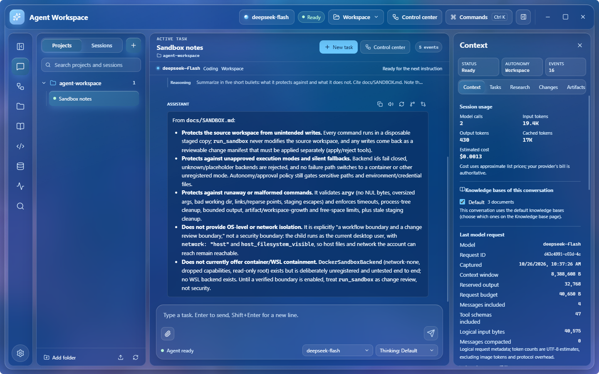
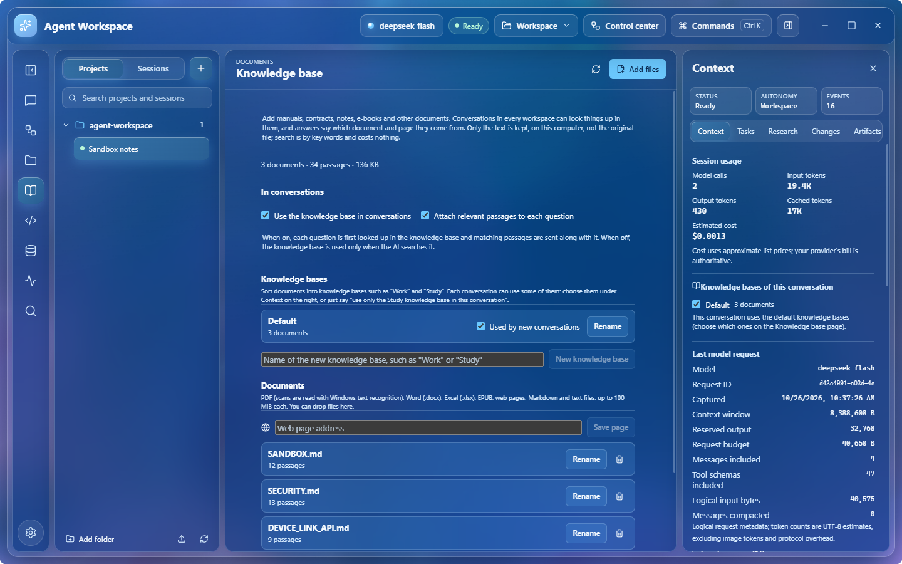
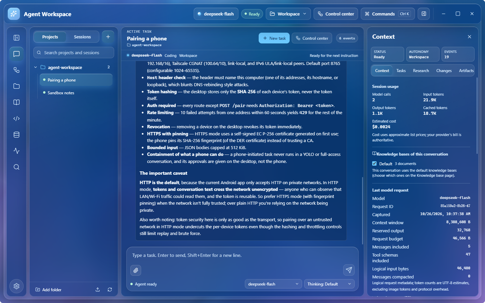
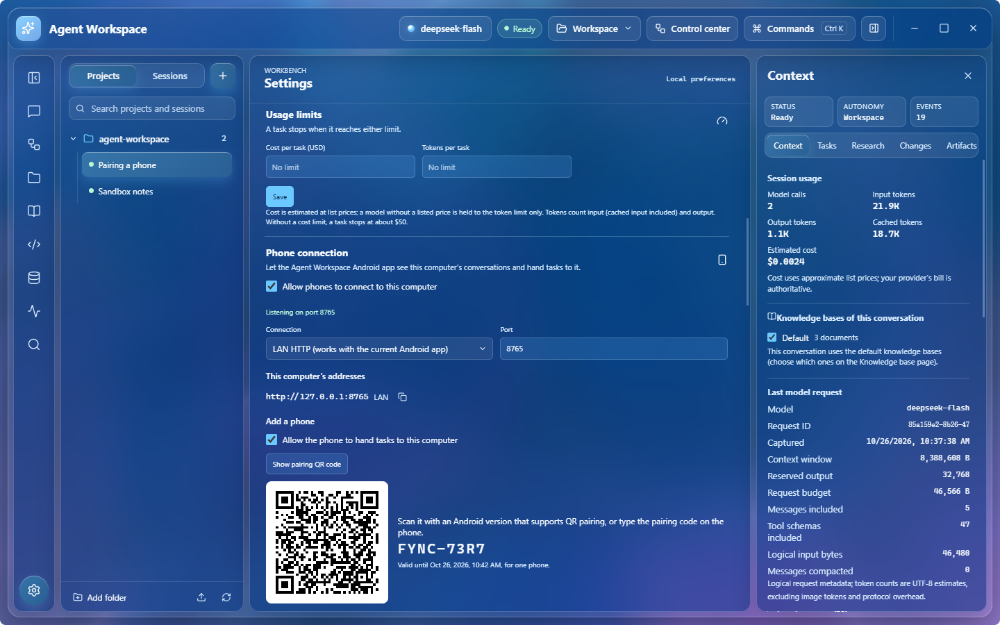

[English](README.md) | [简体中文](README.zh-CN.md)

# Agent Workspace for Windows

A desktop AI agent for Windows. Open a folder, describe the task, and the agent plans and carries
it out with real tools — files, Git, a staged sandbox for commands, a terminal, the web, documents
and your own knowledge base — asking before anything that changes your files or reaches the
network. It works with the cloud model you choose or a model served on your own computer, and
keeps every conversation, change and approval on this machine.

The Android app ([agent-workspace-android](https://github.com/WhitePepperLambSoup/agent-workspace-android))
shares the same Python core; a phone running version 2.5.0 or later can connect to this computer.

> Status: public preview (`0.1.0-alpha`). Windows 10 and 11, x64. Releases are not code-signed yet.

<p align="center">
  
</p>

## Download

Download `AgentWorkspace-Setup-<version>.exe` from the
[latest release](https://github.com/WhitePepperLambSoup/agent-workspace-desktop/releases/latest) and
compare its SHA-256 with the one in the release notes. Windows SmartScreen warns about unsigned
installers: choose "More info", then "Run anyway". Installed copies can update themselves from the
releases page (Settings → About & Updates); they check only when you ask.

## Features

### Conversations and tasks

- **Multi-step tasks**: the agent plans, calls tools and shows every step as it happens —
  streaming replies, reasoning, and each tool call's arguments, result and state.
- **Approvals**: four autonomy levels. Ask approves every action; Workspace allows reads and
  checkpointed writes inside the open folder and asks for the rest; YOLO runs sandboxed work
  without asking; Full access removes routine prompts, as an explicit choice.
- **Talk to a running task**: messages typed while a task runs join it at the next step; others
  wait in a queue that survives restarts.
- **Several conversations at once**: a conversation keeps running in the background while you
  work in another.
- **Fork and compare**: rewrite a message in a new conversation, branch from a reply, or ask the
  same question of another model and compare both answers with their time and tokens.
- **Spending limits**: a per-task limit on cost (at list prices) and tokens; before you send, the
  composer estimates what a task like your recent ones costs. A task that reaches the limit, or
  fails at the provider, stops with the reason in the conversation.
- **Agent runs**: long work split into a plan with sub-agents, each with its own progress,
  approvals and results.

### Workspace and coding

- Read, search, write and patch files; every write keeps a checkpoint so an interrupted change
  rolls back. Moves and deletes check the content they expect.
- **Staged sandbox**: commands run in a private copy of the folder and come back as a changeset
  you review and apply one change at a time.
- Git status, diff, blame, log and staged-only commits; a terminal; background jobs with logs;
  LSP diagnostics and a code map.
- Workspace setup the agent follows: `AGENTS.md`, skills in `.agent/skills`, MCP servers in
  `.agent/mcp.toml` and custom tools in `.agent/tools` — each approved before it first runs.
- A managed browser for pages that need scripts, with screenshots in the conversation.

### Knowledge base

Add manuals, contracts, notes and e-books (PDF, Word, Excel, EPUB, web pages, Markdown and text)
on the Knowledge base page or by asking. Their text is split into passages and indexed on this
computer; conversations in every workspace can search them, and answers cite the document and
page. Scanned PDFs are read with the text recognition built into Windows. Documents can be sorted
into knowledge bases ("Work", "Study"); each conversation uses the ones you choose in the context
panel. Search is by key words with built-in and your own synonyms, so it costs nothing and works
offline.

<p align="center">
  
  
</p>

### Research and memory

- Research mode keeps the pages the agent read as sources and checks that every citation quotes
  them exactly.
- Long-term memory per workspace, searched only when the agent asks for it; you can review, edit
  and delete it.

### Models

- OpenAI-compatible APIs (OpenAI, DeepSeek, Qwen, Kimi, GLM, xAI, OpenRouter and others),
  Anthropic, Gemini and Ollama; presets for llama.cpp, LM Studio and vLLM on your own computer.
- Requests to providers that bill a cached prompt prefix are kept prefix-stable, so repeated
  context is billed at the cached price.
- API keys are stored in Windows Credential Manager, never in files or the database. Before data
  goes to a cloud provider, the egress policy of the autonomy level applies.

### Phone connection

Requires the Android app [agent-workspace-android](https://github.com/WhitePepperLambSoup/agent-workspace-android/releases)
**2.5.0 or later**; earlier versions cannot connect to this release.

Turn on Settings → Phone connection and scan the QR code that appears with the Android app. The
phone and this computer need to be on the same network, or both on Tailscale. The connection uses
HTTPS, and the QR code pins this computer's certificate. If Windows Firewall blocks phones, the
page says so and offers to allow them (Windows asks you to confirm).

Once paired, a phone can:

- hand tasks to a conversation here, and approve or stop what runs here;
- send files, photos, text and links, browse and download files in the open folder, and receive
  files and answers sent from here;
- continue a conversation from one device on the other;
- take requests from this computer's agent (the phone's user accepts each one), and ask this
  computer to do part of a task on the phone;
- receive scheduled results, keep paired knowledge bases in sync, and wake this computer over the
  network when allowed.

Tasks from a phone run with this computer's model. Each phone has its own permissions and can be
removed from either side. The protocol is in [docs/DEVICE_LINK_API.md](docs/DEVICE_LINK_API.md).

<p align="center">
  
</p>

### Interface

- Liquid glass, solid or Mica materials, light and dark, with reduced-motion support.
- Simplified Chinese, Traditional Chinese, English and Japanese.
- Command palette and customizable shortcuts, `/` commands and `@` file mentions, notifications
  when a background task needs you, and session rename, pin, archive, export and import.
- The main surfaces are checked against WCAG 2.2 AA.
- A verified backup of the database each time the app closes (the last ten are kept); logs and
  crash dumps stay on this computer.

## Quick start

1. Install and start Agent Workspace.
2. In Settings → Provider and runtime, add a provider (base URL, model, API key) or pick a local
   preset.
3. Open a folder (the button at the top, or drop the folder on the window).
4. Describe the task. Approve or decline what the agent asks to do; the context panel on the
   right shows what the model receives and what the task costs.

## Build from source

You need Windows, Python 3.12 with [uv](https://docs.astral.sh/uv/), and Node.js 22.

```powershell
uv sync --frozen --python 3.12.10 --all-groups
cd desktop
npm ci
npm run dev
```

The Windows release (Electron app plus the frozen Python sidecar) is built and verified with:

```powershell
uv run --python 3.12.10 python scripts/build_electron_release.py
uv run --python 3.12.10 python scripts/build_electron_release.py --verify dist/electron-release/AgentWorkspace
cd desktop
node node_modules/electron-builder/cli.js --win nsis --x64 --prepackaged ../dist/electron-release/AgentWorkspace
```

The release folder holds `AgentWorkspace.exe`, the sidecar under `resources/sidecar/`, a CycloneDX
SBOM, `SHA256SUMS.txt` and a release manifest. Set `CSC_LINK` and `CSC_KEY_PASSWORD` before running
electron-builder to sign the installer.

The same core also works from the command line: `uv run agent-workspace --help`. Backups, session
archives, logs, updates and signing are covered in [docs/OPERATIONS.md](docs/OPERATIONS.md).

## Project layout

```
src/agent_workspace/   Python core: agent loop, providers, tools, storage, knowledge base,
                       and the UI gateway the desktop app talks to (ui_gateway/)
desktop/               Electron main process, preload and the React renderer
docs/                  architecture, sandbox, background jobs and phone connection protocol
scripts/               release build and verification, architecture checks
```

The desktop app is an Electron shell with a React renderer; a supervised Python sidecar runs the
agent and speaks a bounded NDJSON protocol to it. See [docs/ARCHITECTURE.md](docs/ARCHITECTURE.md).

## Privacy and security

- Conversations, the knowledge base, memory and backups are plaintext SQLite data under
  `%LOCALAPPDATA%\AgentWorkspace`; nothing is uploaded except the requests you send to your model
  provider.
- Tool arguments are validated before approval, side effects are recorded before they run, and
  pages, documents and tool output reach the model as untrusted data.
- The staged sandbox and Windows Job Objects bound commands' effects on the folder and their
  resources, but not their access to the rest of the file system or the network. Use Ask or
  Workspace mode in repositories you do not trust.

The full trust boundary is in [SECURITY.md](SECURITY.md).

## Known limitations

- Windows only; releases are not code-signed yet.
- The sandbox is a review boundary, not an operating-system security boundary.
- Scanned PDFs need the Windows text recognition for their language (installed with the language
  in Windows settings).
- The agent does not operate other desktop applications.

## License

Apache-2.0. Third-party components keep their own licenses; see
[THIRD_PARTY_NOTICES.md](THIRD_PARTY_NOTICES.md).
