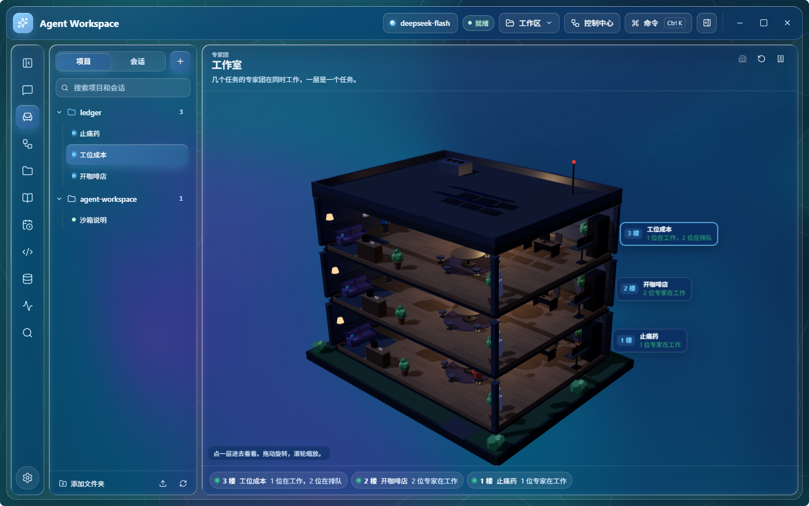
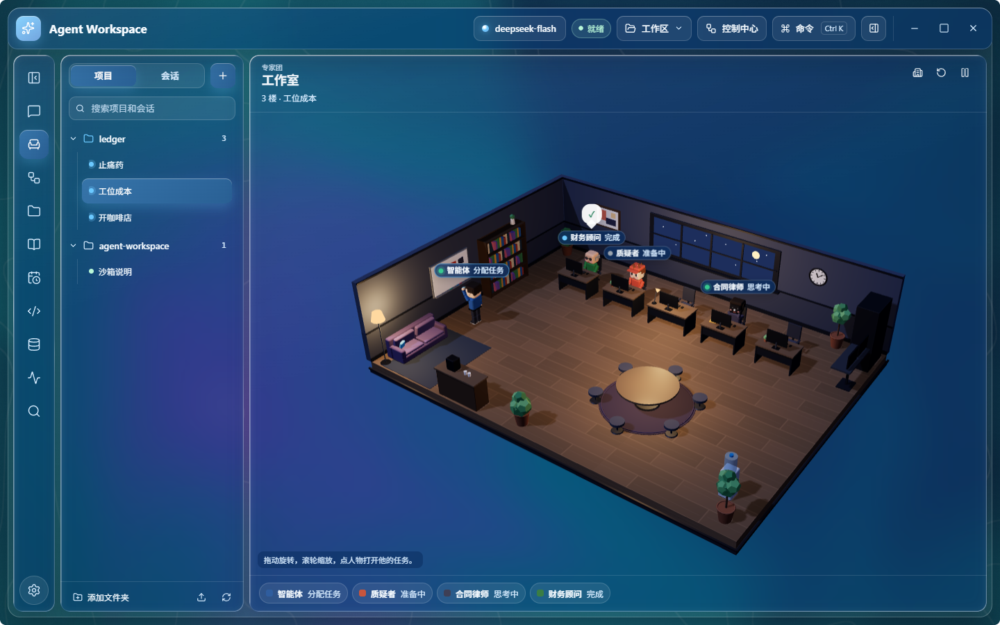
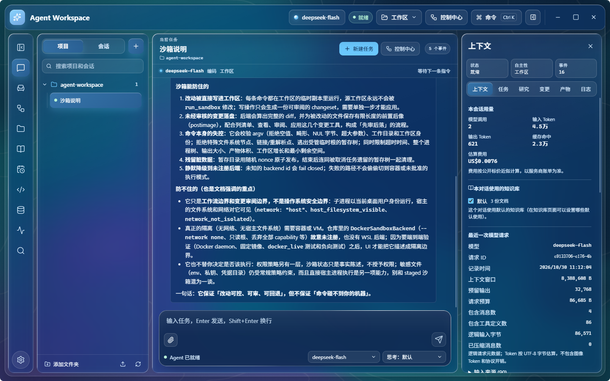
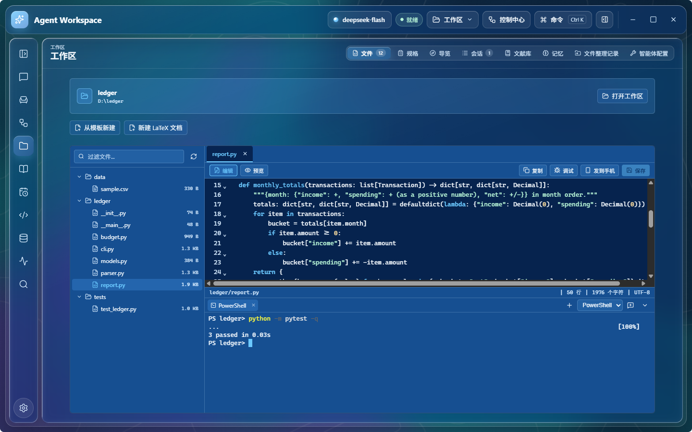
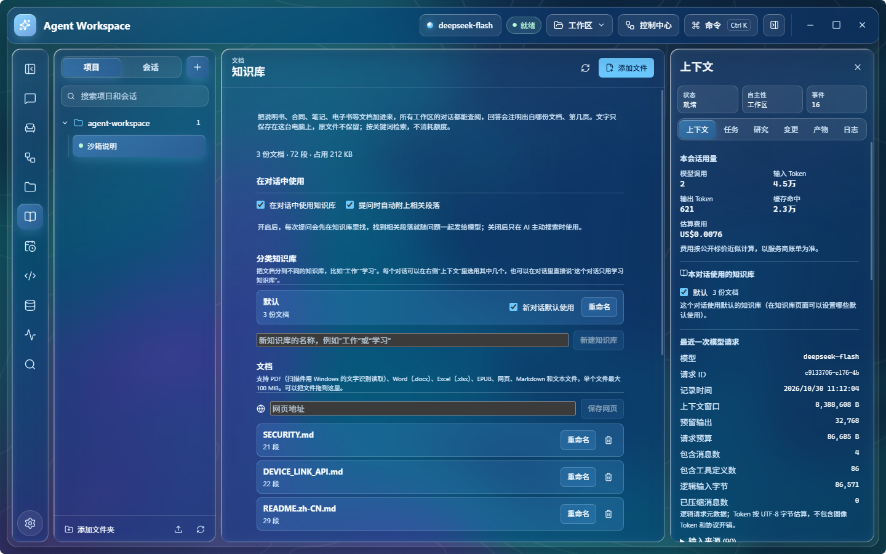
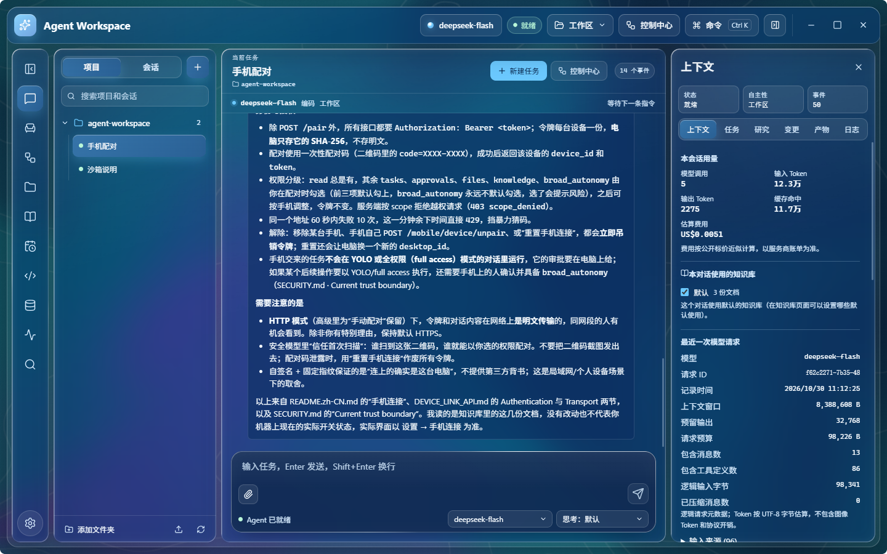
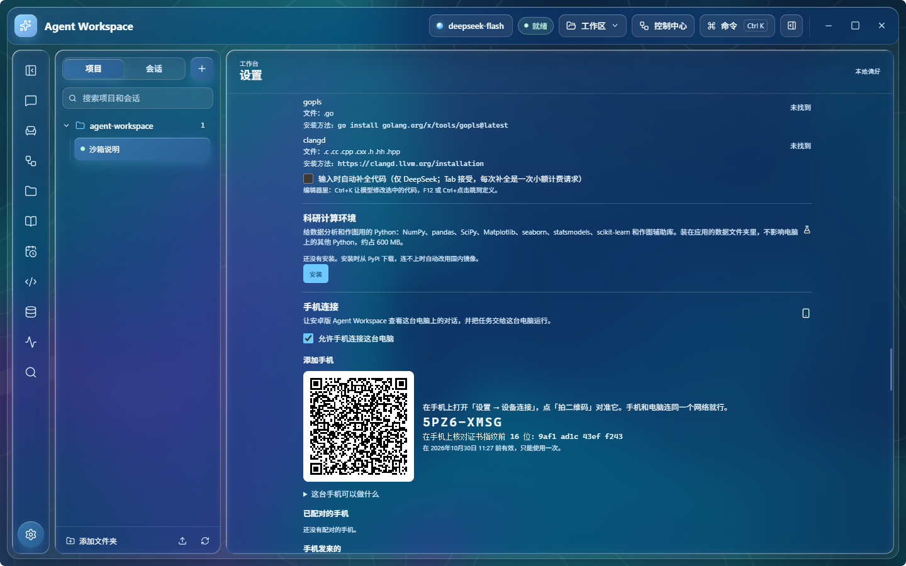

[English](README.md) | [简体中文](README.zh-CN.md)

# Agent Workspace for Windows

运行在 Windows 上的桌面 AI 智能体。打开一个文件夹，说明要做的事，智能体会规划并用真实的工具完成：文件、Git、在暂存沙箱里运行命令、终端、网页、文档和你自己的知识库。改动文件或访问网络之前会先问你。可以用你选的云端模型，也可以用在本机运行的模型；所有对话、改动和审批记录都保存在这台电脑上。一个请求也可以交给由智能体带领的专家团，专家团工作的过程可以在 3D 工作室里看到。

安卓版（[agent-workspace-android](https://github.com/WhitePepperLambSoup/agent-workspace-android)）与它共用同一套 Python 核心；装了 2.5.0 及以上版本的手机可以连接这台电脑。

> 状态：公开预览版（`0.2.0-alpha`），支持 Windows 10 和 11（x64）。安装包暂未做代码签名。

<p align="center">
  
</p>

## 下载

从[最新版本](https://github.com/WhitePepperLambSoup/agent-workspace-desktop/releases/latest)下载 `AgentWorkspace-Setup-<版本号>.exe`，并与版本说明里的 SHA-256 核对。未签名的安装包会被 Windows SmartScreen 拦下：点“更多信息”，再点“仍要运行”。安装后可以从发布页自动更新（设置 → 关于与更新），只在你点检查时才会检查。

## 功能

### 专家团与工作室

把请求发给专家团，由智能体担任组长：从 15 个领域、73 位专家的专家库里挑出这个请求需要的人（也可以用你自己定好的团队），给每人分一部分；回答里有较多数字或涉及重要决定时，再请一位专家审核草稿；最后根据站得住的结论作答。专家们同时工作，各自用本领域的工具；写代码的专家在沙箱里跑自己的测试。

工作室把每个专家团放进一间 3D 办公室：组长在白板前分配任务，专家在工位上查资料、计算或写作，审核在圆桌旁进行。几个对话同时有专家团在工作时，每个对话占一层楼；点一层可以进去看，点一个人可以打开对应的任务。

<p align="center">
  
</p>

### 对话与任务

- **多步骤任务**：智能体自己规划、调用工具，每一步实时可见：流式回复、思考过程，以及每次工具调用的参数、结果和状态。
- **审批**：四种自主级别。“每次询问”每一步都要你同意；“工作区”允许读取和在打开的文件夹内带检查点的写入，其余要问；“YOLO”在沙箱内的操作不再询问；“完全访问”去掉日常审批，需要你明确选择。
- **任务中途插话**：任务执行时输入的消息会在下一步加入当前任务；其他消息进入排队，重启后仍在。
- **同时进行多个对话**：一个对话在后台继续运行，你可以在另一个对话里工作。
- **分叉与对比**：在新对话里改写某条消息、从某条回复分叉，或让另一个模型回答同一个问题，两个回答连同用时和 Token 放在一起对比。
- **花费上限**：给单个任务设费用（按公开标价）和 Token 上限；发送前，输入框会按最近的任务估算这条大约要花多少。达到上限或服务商出错时，任务停下并在对话里说明原因。
- **智能体运行**：把长任务拆成计划和若干子智能体，各自有进度、审批和结果。
- **改动清单**：每个回答下面列出这次任务新建、修改、移动和删除的文件。可以在应用内打开文件、查看文本文件改了什么，也可以逐个或一次撤销智能体的改动。运行命令时改动的文件单独列出。

<p align="center">
  
</p>

### 工作区与编程

- 读取、搜索、写入和修补文件；每次写入都保留检查点，中断的改动会回滚。移动和删除前会核对文件内容。
- **暂存沙箱**：命令在文件夹的私有副本里运行，结果作为一组改动交给你逐项审阅、应用。
- Git 状态、差异、追溯、日志和只提交暂存区；带日志的后台任务；代码地图。
- **编辑器**：语法着色、语言服务器报的错误、悬停说明和跳转到定义。Ctrl+K 按一句说明改写选中的代码，改动确认后才保留；可以打开行内补全（DeepSeek）。
- **语言服务器**：Pyright 和 TypeScript 服务第一次用到时自动安装；电脑上有 rust-analyzer、gopls、clangd 时直接使用。智能体通过它们查找定义、引用和符号，每次编辑后能看到文件里的错误。
- **项目检查**：测试、类型检查和代码规范检查，自动识别或在 `.agent/project.json` 里设置，每个文件夹确认一次；改动了文件的任务结束后自动运行，失败可以交回智能体修。项目规则可以在写入后格式化文件、保护指定路径，并拒绝暂存区里像是含有密钥的提交。
- **终端**：PowerShell、cmd、Git Bash、每个 WSL 发行版和 `~/.ssh/config` 里的 SSH 主机，在工作区下方的面板里（Ctrl+\`）；智能体能读取屏幕上的内容，也能在 WSL 里运行命令。
- **调试器**：在编辑器里设断点，查看 Python 的调用栈和变量（debugpy 第一次用到时安装）。智能体可以停在某一行读取变量。
- **页面检查**：智能体在隐藏的浏览器里打开页面、按步骤点击，拿到控制台错误、失败的请求和截图。
- **审阅改动**：逐块撤销或评论，让模型审阅并把意见写在对应行上，把一条意见交给智能体作为任务。
- **Git**：分支、按差异写提交说明、冲突处理、拉取请求的检查及失败日志（GitHub CLI）、把议题转成任务。
- **规格**：需求、设计和任务清单逐一确认后，智能体再动手实现。
- **仓库导览**：模块及其引用关系图，以及根据代码写出的架构概述。
- **专家团写代码**：写代码的专家有同样的工具，在沙箱里跑自己的测试；组长只把能单独测试的部分分给他们。
- 智能体会遵循工作区里的设置：`AGENTS.md`、`.agent/skills` 里的技能、`.agent/mcp.toml` 里的 MCP 服务和 `.agent/tools` 里的自定义工具，第一次运行前都需要你批准。
- 托管浏览器，用来打开需要脚本渲染的网页，截图会显示在对话里。
- **应用内预览**：回答里的网页链接，以及文件夹里的网页、PDF 和图片，都在窗口内的预览里打开；其他文本文件在阅读视图里打开，Word、Excel、PowerPoint 文件用各自的预览。

<p align="center">
  
</p>

### 知识库

在“知识库”页面添加说明书、合同、笔记、电子书（PDF、Word、Excel、EPUB、网页、Markdown 和文本），也可以在对话里让智能体添加。文字会被切成段落并在本机建立索引，所有工作区的对话都能查阅，回答会注明出自哪份文档、第几页。扫描版 PDF 用 Windows 自带的文字识别读取。文档可以分到不同的知识库（如“工作”“学习”），每个对话在右侧上下文面板里选用其中几个。检索按关键词进行，内置同义词并可自定义，不消耗额度，离线可用。

<p align="center">
  
  
</p>

### 技能

常见工作的做法说明，所有文件夹里的对话都能用：看合同和长文档、分析表格、记账、会议纪要、润色翻译、简历、工作报告、学习卡片、行程、菜单、分账和识别诈骗。它们改编自安卓版的官方技能，去掉了操作手机的部分。对话里只列出名称和用途，请求用得上时智能体才读全文。可以在 设置 → 技能 中逐个开关，也可以把含有 `SKILL.md` 的文件夹（安卓版和其他智能体用的格式）复制到技能文件夹，添加你自己的技能。

### 研究与记忆

- 研究模式把智能体读过的网页保存为来源，并检查每条引用都能在原文中逐字找到。
- 每个工作区有长期记忆，只在智能体主动检索时使用；你可以查看、修改和删除。

### 科研与论文

- **文献**：智能体检索 OpenAlex、arXiv、PubMed、Crossref 和 Semantic Scholar；每个文件夹有自己的文献库（可从 Zotero、BibTeX、RIS、EndNote、NoteExpress 导入）；导出 BibTeX 或按格式排好的列表（GB/T 7714、APA、IEEE、Vancouver、Nature）；按数据库核查参考文献。带名称的追踪只报告以前没报告过的论文，定时任务里的“新论文追踪”模板用的就是它。
- **读论文**：PDF 的目录、页面、搜索和参考文献表；回答里引用的页码可以点开，在软件里直接翻到那一页。
- **文献库页面**：工作区 → 文献库列出文件夹里的文献（含摘要和链接），可以在线检索或从 Zotero 添加，导入 BibTeX、RIS、EndNote、NoteExpress、CSL-JSON 文件，按格式复制参考文献表，保存为 BibTeX 或 RIS，并逐条到数据库核查（信息不符、查不到、已撤稿）。
- **LaTeX**：`.tex` 和 `.bib` 文件在编辑器里打开，旁边是 PDF。可以编译（MiKTeX、TeX Live，或按需安装的 Tectonic），错误用中文说明并可一键修正，检查常见写法问题，源码和 PDF 之间双向跳转（SyncTeX），从文献库或在线检索插入引用，并提供中英文论文、报告和幻灯片的起始模板。`.tex` 文件也可以切换到可视化模式，像 Word 一样编辑（标题、列表、公式、图、表、引用），没有改动的部分逐字保持原样。基于 [TeXButler](https://github.com/WhitePepperLambSoup/texbutler)。
- **数据与作图**：在 设置 → 科研计算环境 中按需安装 Python 环境（numpy、pandas、scipy、matplotlib、statsmodels、scikit-learn 和 Jupyter 工具），附带 [Quick SciPlot](https://github.com/WhitePepperLambSoup/quick-sciplot) 的期刊尺寸样式、统计、图表模板和期刊规范检查。图里的数据点可以拖动来修正原始数据，修正后的副本和改动清单会保存下来，图随之重画。
- **Notebook**：`.ipynb` 文件连同单元格和运行结果一起显示。
- **实验记录本**：按日期记在 `lab-notebook/年-月.md` 里，你说要记录实验时写入，以后可以检索。
- **服务器**：在 SSH 配置里的服务器上运行命令、传输文件、提交和查看 Slurm 作业，使用密钥登录；每一步都需要你批准。
- **导出回答**：回答可以保存为 PDF（公式按显示的样子）、Word 或 Markdown，放在文件夹的 `exports/` 里。

### 办公

- **公文**：按 GB/T 9704 生成通知、请示、报告、函、纪要（版头、发文字号、层次序号、成文日期、版记、页码），检查并修正已有文件的版式，中文校对（标点、错别字、数字日期写法、前后不一致）。
- **Word**：用修订模式改稿并加批注，在 Word 里逐条接受或拒绝；两个版本比对出带修订的文件和修改说明；用表格批量填 Word 模板（每行一个文件或合成一份，也可导出 PDF）；保留排版翻译 Word、PowerPoint、Excel 文件（替换或中外对照）。
- **表格**：带真公式、数字格式、条件格式和原生图表的 Excel；多表合并、按关键列匹配、比对差异并标色、工资条；数电发票（XML、OFD、PDF）汇总、查重、核对金额。
- **PDF**：合并、拆分、选页、删页、旋转、加页码和水印、压缩、图片转 PDF、Office 转 PDF，扫描件加可搜索的文字层（用 Windows 自带的文字识别）。
- **演示文稿**：用你自己的 PowerPoint 模板或本机 Office 自带模板生成，支持原生图表和演讲者备注，太挤的页会提示拆分。
- **邮件与会议**：读取 .eml 和 Outlook .msg，生成回复草稿（只生成文件，由你在邮件程序里发送）和 .ics 会议邀请；会议录音用 设置 → 语音 里选的服务转成带时间的文字稿。
- **模板**：文件页“从模板新建”：公文、表单、证明信函、总结报告、表格，以及你放进模板文件夹、用 `{{字段}}` 标出填写位置的自己的文件。
- **快捷操作**：在任何程序里复制文字或表格截图后按 Ctrl+Alt+Q（可在设置里改），窗口弹到前面，可以润色、中英互译、总结、改成公文语气、写回复，或把表格截图转成 Excel。

智能体写出的每个文件都能在这一轮的改动列表里撤销。

### 模型

- OpenAI 兼容接口（OpenAI、DeepSeek、通义千问、Kimi、智谱 GLM、xAI、OpenRouter 等）、Anthropic、Gemini 和 Ollama；内置在本机运行 llama.cpp、LM Studio、vLLM 的预设。
- 对按提示前缀缓存计费的服务商，请求保持前缀不变，重复的上下文按缓存价格计费。
- API Key 保存在 Windows 凭据管理器中，不写入文件或数据库。数据发往云端服务商之前，按当前自主级别的外发规则处理。

### 手机连接

需要安卓版 [agent-workspace-android](https://github.com/WhitePepperLambSoup/agent-workspace-android/releases) **2.5.0 及以上**；更早的版本连不上这一版。

在 设置 → 手机连接 中打开，用安卓版扫描出现的二维码即可。手机和电脑需要在同一个网络里，或者都装了 Tailscale。连接走 HTTPS，二维码里带着这台电脑的证书指纹。如果 Windows 防火墙拦住了手机，页面会说明并提供一键允许（Windows 会请你确认）。

配对后，手机可以：

- 把任务交给这台电脑上的某个对话，并审批或停止这里正在运行的任务；
- 发送文件、照片、文字和链接，浏览并下载打开的文件夹里的文件，接收这里发过去的文件和回答；
- 把一台设备上的对话拿到另一台上接着进行；
- 接受这台电脑上智能体发来的请求（每个请求都由手机上的人决定是否接受），也可以让这台电脑完成手机任务里的一部分；
- 收到定时任务的结果，让配对的知识库互相补齐，在允许时通过网络唤醒这台电脑。

手机交来的任务使用这台电脑上的模型。每台手机有各自的权限，两边都可以解除配对。协议见 [docs/DEVICE_LINK_API.md](docs/DEVICE_LINK_API.md)。

<p align="center">
  
</p>

### 界面

- 液态玻璃、纯色或 Mica 材质，浅色与深色，支持“减少动画”。液态玻璃的面板、输入框和对话框边缘会折射后面缓慢流动的色块，并带一道随鼠标转动的高光（参考 [liquid-glass](https://github.com/xiaojiaenen/liquid-glass) 的做法），可在 设置 → 外观 中关闭。
- 简体中文、繁体中文、英文和日文界面。
- 命令面板和可自定义的快捷键、`/` 命令和 `@` 引用文件、后台任务需要你时发出通知，对话可以重命名、置顶、归档、导出和导入。
- 主要界面按 WCAG 2.2 AA 检查。
- 每天在后台对数据库做一次校验过的备份（保留最近十份）；日志和崩溃转储只保存在本机。

## 快速开始

1. 安装并启动 Agent Workspace。
2. 在 设置 → 服务商与运行时 中添加服务商（接口地址、模型、API Key），或选择本机模型的预设。
3. 打开一个文件夹（点顶部的按钮，或把文件夹拖进窗口）。
4. 说明要做的事。同意或拒绝智能体请求的操作；右侧上下文面板显示模型收到了什么、任务花了多少。

## 从源码构建

需要 Windows、Python 3.12 和 [uv](https://docs.astral.sh/uv/)，以及 Node.js 22。

```powershell
uv sync --frozen --python 3.12.10 --all-groups
cd desktop
npm ci
npm run dev
```

构建并校验 Windows 发布包（Electron 应用加冻结的 Python sidecar）：

```powershell
uv run --python 3.12.10 python scripts/build_electron_release.py
uv run --python 3.12.10 python scripts/build_electron_release.py --verify dist/electron-release/AgentWorkspace
cd desktop
node node_modules/electron-builder/cli.js --win nsis --x64 --prepackaged ../dist/electron-release/AgentWorkspace
```

发布目录包含 `AgentWorkspace.exe`、`resources/sidecar/` 下的 sidecar、CycloneDX SBOM、`SHA256SUMS.txt` 和发布清单。运行 electron-builder 前设置 `CSC_LINK` 和 `CSC_KEY_PASSWORD` 即可为安装包签名。

同一套核心也可以在命令行使用：`uv run agent-workspace --help`。备份、对话归档、日志、更新和签名见 [docs/OPERATIONS.md](docs/OPERATIONS.md)。

## 目录结构

```
src/agent_workspace/   Python 核心：智能体循环、服务商、工具、存储、知识库，
                       以及桌面应用连接的界面网关（ui_gateway/）
desktop/               Electron 主进程、preload 和 React 渲染进程
docs/                  架构、沙箱、后台任务和手机连接协议
scripts/               发布构建与校验、架构检查
```

桌面应用是 Electron 外壳加 React 渲染进程；一个受监管的 Python sidecar 运行智能体，两者之间用有界的 NDJSON 协议通信。详见 [docs/ARCHITECTURE.md](docs/ARCHITECTURE.md)。

## 隐私与安全

- 对话、知识库、记忆和备份是 `%LOCALAPPDATA%\AgentWorkspace` 下的明文 SQLite 数据；除了你发给模型服务商的请求，什么都不会上传。
- 工具参数在审批前校验，副作用在执行前记录；网页、文档和工具输出以“不受信任的数据”交给模型。
- 暂存沙箱和 Windows 作业对象限制命令对文件夹的影响和资源用量，但不限制它们访问其他文件或网络。在不信任的仓库里请使用“每次询问”或“工作区”模式。

完整的信任边界见 [SECURITY.md](SECURITY.md)。

## 已知限制

- 仅支持 Windows；安装包暂未签名。
- 沙箱是审阅边界，不是操作系统级的安全隔离。
- 扫描版 PDF 需要 Windows 装有对应语言的文字识别（在 Windows 设置里添加该语言时安装）。
- 智能体不会操作电脑上的其他应用。

## 许可证

Apache-2.0。第三方组件保留各自的许可证，见 [THIRD_PARTY_NOTICES.md](THIRD_PARTY_NOTICES.md)。
